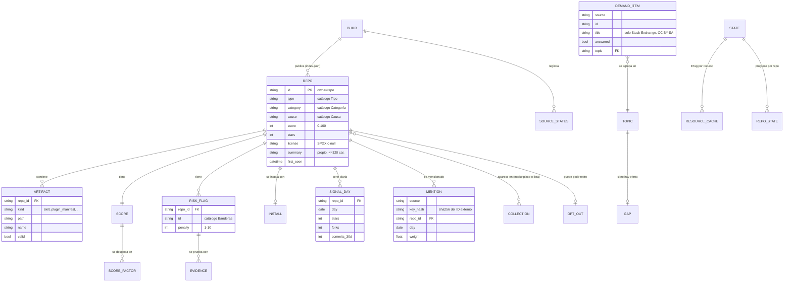

# Modelo de datos

Skillscope no tiene base de datos: el pipeline genera **archivos JSON versionados** (`schema_version`) que el sitio estático consume. Los cambios de esquema se hacen con migraciones en código (`pipeline/migrations.py`), igual que se haría con Alembic: cada versión sabe convertir la anterior.
Las reglas citan la fuente con `#n` ([investigacion.md](investigacion.md)).

## 1. Diagrama entidad-relación

## 2. Archivos

| Archivo | Dónde vive | Publicado | Contenido |
|---|---|---|---|
| `data/index.json` | sitio | Sí | Build, totales, estado de fuentes, lista ligera y listas derivadas. Es también la **API pública**. |
| `data/detail/<categoria>.json` | sitio | Sí | Ficha completa de cada repo de esa categoría (shards para no descargar todo). |
| `data/embeddings.bin` + `data/embeddings.json` | sitio | Sí | Vectores int8 de documentos y términos + mapa de ids, vocabulario e idf. |
| `data/demand.json` | sitio | Sí | Preguntas de demanda (con atribución), temas y huecos. |
| `data/signals.json` | sitio | Sí | Serie diaria compacta (60 días) por repo. También sirve de respaldo para restaurar el estado. |
| `feed.xml`, `feed.json` | sitio | Sí | Boletín RSS 2.0 y JSON Feed 1.1. |
| `s/<owner>/<repo>/index.html`, `sitemap.xml`, `badge/<owner>/<repo>.svg` | sitio | Sí | Página estática por repo con schema.org, mapa del sitio e insignia. |
| `repos.json` | caché de Actions | No | Análisis completo (fuente de los shards). |
| `state.json` | caché de Actions | No | ETag, cursores, cola de candidatos y progreso por repo. |
| `mentions.json` | caché de Actions | No | Eventos de mención deduplicados (180 días). |
| `data/raw/AAAA-MM-DD/<fuente>/<sha256>.json` | caché de Actions | No (ignorado en git) | Respuesta cruda con hash y fecha, para reproducir un análisis. |

## 3. Catálogos

**Tipo** (`type`): `skill` skill suelta · `plugin` · `marketplace` marketplace/colección · `mcp_server` servidor MCP · `agent` agente · `command` comando · `hook` · `awesome_list` lista awesome · `template` plantilla.
Regla de asignación (la primera que se cumple): `marketplace.json` válido en `.claude-plugin/` (#4) → `marketplace`; `plugin.json` en `.claude-plugin/` (#3) → `plugin`; uno o más `SKILL.md` (#1, #2) → `skill`; dependencia `@modelcontextprotocol/sdk`, `mcp` o `fastmcp` en el manifiesto del paquete → `mcp_server`; archivos en `agents/` o `.claude/agents/` (#11) → `agent`; en `commands/` o `.claude/commands/` (#1) → `command`; `hooks/hooks.json` o hooks en settings (#3) → `hook`; nombre o topics con `awesome` y ≥ 10 enlaces a GitHub → `awesome_list`; `isTemplate` → `template`.

**Categoría** (`category`): `development` desarrollo · `testing` pruebas · `code_review` revisión de código · `devops` DevOps/CI · `security` seguridad · `data` datos y BI · `ai_ml` IA/ML · `docs_writing` documentación y escritura · `design_ux` diseño/UX · `productivity` productividad y oficina · `finance_legal` finanzas y legal · `research` investigación · `education` educación · `integrations` integraciones.

**Causa** (`cause`): `automate` automatizar tarea repetitiva · `standardize` estandarizar un estilo · `comply` cumplir una norma · `onboard` acelerar la incorporación de gente nueva · `integrate` integrar una herramienta externa · `reduce_errors` reducir errores · `generate_docs` generar documentos.

Categoría y causa se asignan con léxicos ponderados (español e inglés) sobre nombre, topics, descripciones de las skills y palabras clave; cada asignación guarda las palabras que la justificaron. Detalle en [algoritmo.md](algoritmo.md).

**Banderas de riesgo** (penalización total máxima 25, #7, #30):

| id | Severidad | Penaliza | Se activa cuando |
|---|---|---|---|
| `prompt-injection` | alta | 10 | Frases para anular instrucciones o esconder acciones al usuario, caracteres invisibles o bidireccionales, comentarios HTML con órdenes, bloques base64 largos en Markdown. |
| `exec-unexplained` | alta | 8 | Ejecuta comandos (scripts, hooks, `` !`cmd` ``, `bin/`, servidores MCP stdio) y la documentación no los menciona. |
| `downloads-binary` | alta | 8 | `curl … \| sh`, descarga de ejecutables o archivos comprimidos, `chmod +x` tras descargar, paquetes MCP desde URL. |
| `requests-credentials` | media | 6 | Pide o lee claves, tokens o contraseñas (`~/.ssh`, `~/.aws`, `.env`, «pega tu API key»). |
| `obfuscated-code` | media | 6 | `eval`/`exec` de cadenas decodificadas o líneas minificadas enormes en scripts. |
| `network-exfil` | media | 6 | Envía datos a URLs externas desde scripts o hooks (`curl -d/-F`, webhooks). |
| `broad-permissions` | media | 5 | `allowed-tools`/`tools` con `Bash` sin restricción, `bypassPermissions` o `--dangerously-skip-permissions`. |
| `no-license` | media | 4 | Sin licencia detectada (#27). |
| `unpinned-deps` | media | 4 | `npx`/`uvx`/`pip install` sin versión, rangos `^`/`~`/`*`/`latest`, `source` de GitHub sin `sha`. |
| `exec-declared` | baja | 2 | Ejecuta comandos y sí lo explica (informativa). |

**Nivel de riesgo**: `0` ninguno (0 puntos) · `1` bajo (1–5) · `2` medio (6–12) · `3` alto (≥ 13).

## 4. Campos

### 4.1 `index.json` (build)

| Campo | Tipo | Restricción | Regla / fuente |
|---|---|---|---|
| `schema_version` | int | = 1 | Migraciones en `pipeline/migrations.py` |
| `build_id` | string | `AAAAMMDDTHHMMSSZ-<7 hex>`, único | El navegador lo compara para saber si hay datos nuevos |
| `built_at` | string | ISO 8601 UTC | La web muestra esta hora real, no la de descarga (S7) |
| `site_url` | string | URL absoluta con `/` final | Para feeds, sitemap e insignias |
| `totals` | objeto | conteos ≥ 0 | `repos`, `artifacts{skills,plugins,commands,agents,hooks}`, `by_type`, `by_category`, `by_risk` |
| `sources[]` | lista | `status ∈ {ok, partial, failed, skipped}` | Una fuente caída no detiene el build; queda aquí con `reason` |
| `files` | objeto | rutas relativas con `?v=<hash>` | Para invalidar la caché del navegador solo cuando cambian |
| `items[]` | lista de `IndexItem` | ≤ `SKILLSCOPE_INDEX_MAX` (6.000) ordenados por puntaje | Rendimiento (Lighthouse ≥ 95) |
| `lists` | objeto | ids | `most_used`, `most_mentioned`, `trending`, `most_useful`, `safest`, `riskiest` (≤ 50 c/u) y `most_needed` (categorías) |

### 4.2 `IndexItem` (lista ligera)

| Campo | Tipo | Restricción | Regla / fuente |
|---|---|---|---|
| `id` | string | `owner/repo`, único | Nombre canónico de la API |
| `owner`, `name` | string | — | — |
| `type`, `category`, `cause` | enum | catálogos §3 | — |
| `categories` | enum[] | ≤ 2 secundarias | — |
| `score` | int | 0–100 | [algoritmo.md](algoritmo.md) |
| `components` | objeto | `quality` 0–25, `maintenance` 0–20, `adoption` 0–20, `social` 0–15, `utility` 0–20, `risk` 0–25 | §7 del enunciado |
| `risk` | objeto | `level` 0–3, `penalty` 0–25, `flags` ids | Catálogo de banderas |
| `stars`, `forks` | int | ≥ 0 | GraphQL `stargazerCount`, `forkCount` |
| `pushed_at` | string | ISO 8601 | — |
| `license` | string \| null | SPDX o `null` | `licenseInfo.spdxId` (#27) |
| `summary` | string | ≤ 320 car., **texto propio**, ≤ 15 palabras seguidas en común con el README | Derechos de autor (#25, #27) |
| `keywords` | string[] | ≤ 16 palabras sueltas | Alimentan el BM25 del navegador |
| `install` | string \| null | ≤ 300 car. | Comando principal (#4, #6, #8, #10) |
| `counts` | objeto | `skills`, `plugins`, `commands`, `agents`, `hooks` ≥ 0 | — |
| `first_seen` | string | ISO 8601 | Etiqueta «nuevo» durante 1 h |
| `mentions_30d` | number | ≥ 0 | Media móvil de 30 días ponderada |
| `trend` | number | ≥ 0 | Crecimiento relativo de 7 días |
| `co` | string[] | ≤ 5 ids | Co-ocurrencia en colecciones («se usan junto con eso») |
| `sample` | bool | solo datos de ejemplo | Los repos ficticios no enlazan a GitHub |

### 4.3 `RepoDetail` (shard por categoría)

| Campo | Tipo | Restricción | Regla / fuente |
|---|---|---|---|
| `what` | string | 2–3 frases propias | Qué hace |
| `when` | string[] | ≤ 6 frases cortas propias | Cuándo usarla (derivado de las palabras clave de las descripciones, no copiado) |
| `install` | objeto | `kind ∈ {marketplace, plugin_dir, skill_copy, mcp, template, list, manual}`, `steps[{label, command}]`, `note` | #4, #6, #8, #10, #11 |
| `risks[]` | lista | `{id, severity, penalty, title, why, evidence[{path, line, snippet ≤ 100 car.}]}` ≤ 3 evidencias por bandera | #7, #30 |
| `score` | objeto | `components[{id, label, points, max, factors[{id, label, value, points, max}]}]` | Auditable |
| `artifacts[]` | lista | ≤ 50; `{kind, path, name, valid, issues[]}` | #1–#5, #11 |
| `tools[]` | string[] | herramientas declaradas (`allowed-tools`, `tools`) | #1, #11 |
| `readme_lang` | string | ISO 639-1 o `und` | Detector propio por palabras vacías y escritura |
| `collections[]` | string[] | ids de marketplaces y listas que lo incluyen | Adopción |
| `topics[]` | string[] | — | GitHub |
| `signals` | objeto | `stars` 30 días, `mentions{fuente: n}` | Sparkline |

### 4.4 `demand.json`

| Campo | Tipo | Restricción | Regla / fuente |
|---|---|---|---|
| `items[]` | lista | Solo Stack Exchange trae `title`, `url`, `author`, `author_url`, `license = "CC BY-SA"` | Atribución obligatoria (#34, #35) |
| `items[].answered` | bool | `is_answered` o respuesta aceptada | Demanda sin solución |
| `aggregates[]` | lista | `{source, topic, category, count, window_days}` | Reddit: solo conteos (#36) |
| `topics[]` | lista | `{id, label, keywords[], category, demand, supply, matched[]}` | Agrupación por léxico de categoría + palabras clave |
| `gaps[]` | lista | `{topic, category, demand, supply, ratio, examples[] ≤ 3}` | HUECO = demanda alta y oferta vacía |

### 4.5 `signals.json`

| Campo | Tipo | Restricción |
|---|---|---|
| `days` | string[] | 60 fechas `AAAA-MM-DD` consecutivas |
| `repos.<id>.stars` / `forks` / `commits_30d` | (int \| null)[] | alineados con `days` |
| `repos.<id>.mentions.<fuente>` | (int \| null)[] | alineados con `days` |

### 4.6 `state.json` (interno)

| Campo | Tipo | Contenido |
|---|---|---|
| `resources.<clave>` | objeto | `etag`, `last_modified`, `body_sha256`, `fetched_at` (la clave nunca incluye tokens) |
| `cursors` | objeto | Rebanadas de fecha por consulta (`from`, `to`, `count`, `page`), cursores de fuentes sociales |
| `schedule.<fuente>` | string | Próxima ejecución permitida (cadencia de [fuentes.md](fuentes.md)) |
| `repos.<id>` | objeto | `head_oid`, `analyzed_oid`, `first_seen`, `last_seen`, `status ∈ {artifact, no_artifact, gone, opted_out}` |
| `frontier[]` | lista | `{id, priority, via[]}` candidatos pendientes |

## 5. Reglas de negocio

| # | Regla | Fuente |
|---|---|---|
| R1 | Una skill es **válida** si su `name` cumple `^[a-z0-9]+(-[a-z0-9]+)*$`, ≤ 64 car. y coincide con la carpeta, y si `description` tiene 1–1.024 car. Claude Code es más permisivo (todo opcional), así que la ficha muestra aparte «carga en Claude Code». | #1, #2 |
| R2 | El frontmatter solo se lee si `---` es la primera línea; YAML con `safe_load`, sin alias (anti «billion laughs») y máximo 16 KB. | #1, #29 (A05, A08) |
| R3 | `plugin.json`: solo `name` obligatorio (kebab-case); rutas con `./` y sin `..`. | #3 |
| R4 | `marketplace.json`: `name`, `owner.name` y `plugins[]` obligatorios; cada entrada con `name` y `source`; nombre reservado fuera de `github.com/anthropics/` = no instalable. | #4, #5 |
| R5 | Comando de instalación según tipo: marketplace → `/plugin marketplace add owner/repo` + `/plugin install 
@<m>`; plugin sin marketplace → `claude --plugin-dir`; skill suelta → copiar a `~/.claude/skills/<nombre>/`; MCP publicado en npm → `claude mcp add <n> -- npx -y <paquete>@<versión>`. | #4, #6, #8, #10 |
| R6 | El resumen es propio y nunca comparte más de 15 palabras seguidas con el README (prueba automática). | #25, #27 |
| R7 | No se publica ningún correo (`owner.email`, `author.email`) aunque esté en los manifiestos. | #26, LOPDP (minimización) |
| R8 | Preguntas de Stack Exchange: título + enlace + autor + «CC BY-SA» + «Stack Exchange» visibles. | #34, #35 |
| R9 | Reddit: solo conteos agregados, sin texto ni identificadores. | #36 |
| R10 | Un repo con retiro pedido (topic, issue o archivo) no se publica ni se analiza. | §11 del enunciado |
| R11 | Las redes sociales nunca generan una recomendación: solo puntúan. | §1 del enunciado |
